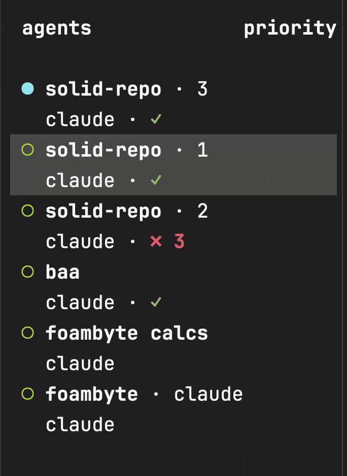

# baa

**uh-oh or all good.**

A tiny [Herdr](https://herdr.dev) plugin. When a coding agent finishes its turn, baa
checks that the agent's project still compiles and shows the verdict next to the agent
in Herdr's sidebar:

| Token | Meaning |
|---|---|
| `…` | checking |
| `✓` | all good |
| `✗ 3` | uh-oh: 3 errors |
| `✗` | uh-oh, error count unknown |
| `⏱` | the check timed out |
| *(nothing)* | not a project baa knows; it stays quiet |

<!-- TODO: replace with a recording -->


## Install

```sh
herdr plugin install rsdlt/baa
```

This builds baa with `cargo build --release`, so you need a Rust toolchain (1.89 or
newer). It requires Herdr 0.8.0 or newer, on Linux or macOS.

The `baa` binary is also on crates.io as `cargo install herdr-baa`. The plugin itself
always runs the copy it builds, so you only need this to run `baa` by hand.

To hack on baa, link a checkout instead. `link` doesn't run the build step, so build first:

```sh
cargo build --release
herdr plugin link .
```

## Show `$baa` in the sidebar

baa reports a pane metadata token called `baa`. Herdr shows it once you add `$baa` to the
Agent sidebar rows in `~/.config/herdr/config.toml`. For example, to put it after the
agent name in the default layout:

```toml
[ui.sidebar.agents]
rows = [
  ["state_icon", "machine", "workspace", "tab"],
  ["agent", "$baa"],
]
```

Then run `herdr server reload-config`, or choose *reload config* from the global menu.

On Herdr 0.9.0 and newer you can also colour it:

```toml
[ui.sidebar.agents]
rows = [
  ["state_icon", "machine", "workspace", "tab"],
  ["agent", { token = "$baa", rules = [
    { starts_with = "✓", fg = "#98c379" },
    { starts_with = "✗", fg = "#e06c75", bold = true },
    { starts_with = "⏱", fg = "#e5c07b" },
  ] }],
]
```

## What gets checked

baa walks up from the agent's working directory to the nearest project root and uses the
first match:

| Marker | Check | Error count |
|---|---|---|
| `.baa.toml` | your `command` | exit code only, unless you set `error_marker` |
| `Cargo.toml` | `cargo check --message-format=short` | lines with `: error[` / `: error:` |
| `tsconfig.json` | the project's own `node_modules/.bin/tsc --noEmit` | lines with `: error TS` |

baa never installs anything and never runs `package.json` scripts on its own. If a
project has no local `tsc`, baa stays quiet. Checks time out after 60 seconds. Note that
`cargo check` writes to the project's `target/` like any other cargo build.

Every agent working in the same project shows the same verdict. If several agents finish
while a check is running, baa runs one more check when it ends, not one per agent.

### `.baa.toml`

Drop a `.baa.toml` at a project root to use your own check or tune the built-in one. Every
field is optional:

```toml
command = ["just", "check"]   # replaces the built-in check
timeout_secs = 120            # default 60
error_marker = ": error"      # count output lines containing this text
```

Without `command`, the built-in check for that directory runs with your other settings.

> **Note:** override commands run as your user, with your permissions, every time an agent
> finishes a turn. Only put commands in `.baa.toml` that you would run yourself.

## Actions

Open Herdr's command palette and look for:

- **baa: check this project now**: re-check the focused pane's project.
- **baa: show last check output**: open a popup with the last check's full output
  (press `q` to close).
- **baa: clear tokens and saved state**: remove every `$baa` token and everything baa
  has saved.

## How it works

baa subscribes to `pane.agent_status_changed`. A turn counts as finished on `done`, or
on `working` → `idle`. The hook itself only decides and hands off to a detached worker,
so Herdr is never kept waiting. The worker holds a per-project file lock, runs the check
with a timeout, and writes the token to every agent pane in that project.

State (last status per pane, last output per project, and a log) lives in
`HERDR_PLUGIN_STATE_DIR`. Anything that goes wrong (no toolchain, a missing binary, a
malformed event) is written to `baa.log` there and to `herdr plugin log list --plugin
rsdlt.baa`. baa never crashes or shows a noisy error.

## License

Apache-2.0, same as Herdr.
